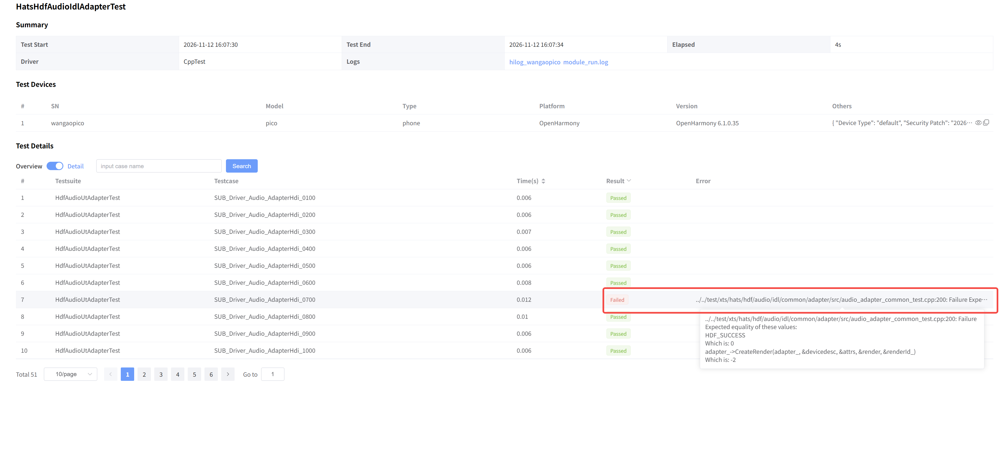

<!--
 * Copyright 2022-2023 SPACEMIT. All rights reserved.
 * Use of this source code is governed by a BSD-style license
 * that can be found in the LICENSE file.
 *
 * @Author: Wangao162
 * @Date: 2026-11-25
 * @FilePath: \doc\docs-openharmony\zh\technical_topics\xts\1_OH_xts_compatibility_test.md
 * @Description: OpenHarmony 兼容性测评指南
-->
sidebar_position: 1

# OpenHarmony兼容性测评指南

OpenHarmony 兼容性测评服务包括产品兼容性技术规范文档（PCS）与兼容性测试（XTS）两部分。

## 主要网站

- XTS 测试指导网站：[OpenAtom OpenHarmony](https://www.openharmony.cn/testGuidelines)
- XTS 送测网站：[OPENATOM](https://legacy.openatom.cn/signin-oAuth?response_type=code&client_id=6bdacef0a8bd11ec938bd9550d2decfd&scope=userBasicInfo&redirect_uri=https%3A%2F%2Fcompatibility.openharmony.cn%2Fconsole%3Fstate%3D)
- PCS 自检表格下载网站：[OpenAtom OpenHarmony](https://www.openharmony.cn/systematic)
- 兼容性测试套件和 resource 下载网站：[OpenAtom OpenHarmony](https://www.openharmony.cn/systematic?tab=xts)

## XTS 简介

XTS 测试分为几大测试模块：

- **ACTS**（Application Compatibility Test Suite）：应用兼容性测试套件，看护北向 HAP 兼容与 OpenHarmony 开发 API 兼容。
- **ACTS-VALIDATOR**：应用兼容性补充测试套件，需要根据引导完成手工测试。
- **HATS**（Hardware Abstraction Test Suite）：硬件抽象兼容性测试套，看护 HDI 层接口。
- **DCTS**（Distributed Compatibility Test Suite）：分布式兼容性测试套，看护分布式兼容性。
- **SSTS**（System Security Test Suite）：系统安全漏洞测试套，看护已知系统安全漏洞补丁的修复情况。

各类系统对几个组件的要求情况如下，PCS 自检表中对不同的系统有更详细的要求。

| 测试分类 | 轻量系统 | 小型系统 | 标准系统 |
| --- | --- | --- | --- |
| acts | Y | Y | Y |
| acts-validator | N | N | Y（支持 ArkTS 应用 + 带屏产品涉及） |
| hats | N | N | Y |
| dcts | N | N | Y（带屏产品涉及） |
| ssts | N | N | Y |

## XTS 认证流程概述

通常标准系统使用居多。由于 SpacemiT 为 **riscv64** 平台，OpenHarmony 官方（以下简称为 **OH 官方**）并没有提供 riscv 平台的套件，所以需要自行编译套件。进行本地测试通过后，在送测网站注册账号并提交送测申请，等待 14 个工作日 OH 官方评测组会给出结果。通常第一次送测都会有问题然后打回来修改，修改完后再送测，平均反复 2~3 次可以通过。

## 1. 网站注册

在 [OPENATOM](https://legacy.openatom.cn/signin-oAuth?response_type=code&client_id=6bdacef0a8bd11ec938bd9550d2decfd&scope=userBasicInfo&redirect_uri=https%3A%2F%2Fcompatibility.openharmony.cn%2Fconsole%3Fstate%3D) 网站上优先进行公司账户的注册，注册后提供公司名称、社会识别码、运营执照完成公司认证。优先申请**分布式测试盒子**来为 dcts 测试做准备。

分布式测试盒子资源比较紧缺，要等半个月左右，如果申请后显示排队时间会进一步拉长。如果有社区的 DAYU 开发板，可以参照网站 2026-09-03 公告 [OpenAtom OpenHarmony](https://compatibility.openharmony.cn/console/#/bulletin/9abde17afce04ca5a62f2affb1c1975a) 自行做一个出来。

## 2. 系统参数修改

XTS 会检查一些参数，这些参数在板子内、网站申请、快递清单、XTS 报告里必须保持一致。

这些需要的参数可以通过下载的 PCS 自检表里的 sheet 页面来查看。板子上的实际内容则通过 `begetctl dump api` 指令获取相关系统参数，根据获取到的内容进行填写。（XTS 兼容性测试工作组会将填写内容与测试报告当中披露的字段进行匹配，匹配不一致将会驳回测评流程。）

## 3. 本地编译 XTS 套件

```text
test
|-- ostest
|   `-- wukong
|-- testfwk
|   |-- arkxtest
|   |-- developer_test
|   |-- testfwk_cangjie_wrapper
|   `-- xdevice
`-- xts
    |-- acts
    |-- dcts
    |-- device_attest
    |-- device_attest_lite
    |-- hats
    `-- tools
```

进入工作区根目录的 **test 目录**，分别在 acts、dcts、hats 里执行编译命令：

```bash
./build.sh product_name=${PRODUCT_NAME} system_size=standard target_arch=riscv64
```

进迭时空已经对套件做了 riscv64 适配，可以直接指定该架构编译。

> **注意**：不可以修改用例内容，用例有问题可以申请豁免。其中编译 acts 时会同步编译出 acts 和 acts-validator 两个套件。

编译出的测试套件会生成在 `out/${PRODUCT_NAME}/suites/` 下：

```text
suites
|-- acts
|   |-- acts
|   |-- acts-validator
|   `-- iotc-validator
|-- dcts
|-- haps
`-- hats
```

将 suites 目录整个拷贝到 Windows 上运行。

## 4. Windows 运行 XTS 套件

概括为三个步骤：准备运行环境 → 推入测试资源 → 开始跑全量测试。

测试前请将产品目标功能都确保 OK 并打开，如连接好能 ping 通公网的 Wi-Fi / 以太网、打开蓝牙 / NFC、插好 SIM 卡等。Windows 主机需要提前安装好 Python，详细步骤可参照 [OpenAtom OpenHarmony](https://www.openharmony.cn/testGuidelines)，本文不做赘述。

按照官网 [OpenAtom OpenHarmony](https://www.openharmony.cn/testGuidelines) 内的章节“标准系统 xxxx 测试指导”指引的操作，大概步骤为：先下载好资源文件，然后在对应套件的 `run.bat` 所在的目录执行 **run.bat**，会自动检查下载一些依赖，下载完成后，在各个套件目录分别执行：

```bash
run acts    # 时长大概三天
run hats    # 时长大概两个小时
run dcts    # 时长大概一个半小时
run ssts    # 时长大概一分钟
```

模块执行（以 hats 为例，具体模块可以查看 `\hats\testcases`）：

```bash
run -l HatsSamgrTest
```

推荐使用 PowerShell 跑，cmd 跑测试出现过偶尔等待十几秒的问题，可能与控制台窗口的快速编辑模式有关。

> **不同测试部件需要做的操作会略有不同，请注意看官方指导文档。**

下面是具体的操作步骤。

### acts 测试

1. 下载对应 resource 文件，拷贝到 `acts\resource` 目录下。
2. 执行 `acts\run.bat`，待命令行出现后，执行 `run acts` 开始测试。
3. 待测试完成，进入 `acts\reports\`，获取当前的执行记录，打开 `summary_report.html` 可以获取到测试报告。

### acts_validator 测试

1. 下载对应 resource 文件，拷贝到 `acts-validator\resource` 目录下。
2. 执行 `acts-validator\run.bat`，输入命令 `run validator -ta update:true`，完成辅助资源的推送安装。
3. 按官网指导执行兼容性测试套件，主要为点击 HAP。
4. 待测试完成，进入 `acts-validator\reports\`，获取当前的执行记录，打开 `summary_report.html` 可以获取到测试报告。

### hats 测试

1. 下载对应 resource 文件，拷贝到 `hats\resource` 目录下。
2. 执行 `hats\run.bat`，待命令行出现后，执行 `run hats` 开始测试。
3. 待测试完成，进入 `hats\reports\`，获取当前的执行记录，打开 `summary_report.html` 可以获取到测试报告。

### dcts 测试

1. 下载 resource 文件，拷贝到 `dcts\resource` 目录下。

   下载的 dcts 资源文件中有两个 arm64 的 bin 文件，即 `resource\data\64` 下的 `bitsocketdsoftbusTest` 和 `dsoftbusTest`，在 riscv 上无法使用，需要用我们自己编译的套件里的同名文件进行替换，文件在 `dcts\testcases` 下。

   然后执行 `dcts\resource` 目录下的 `dcts_resource.bat`，将 dcts 所需测试辅助资源文件和二进制 push 到标准系统设备，完成后设备自动重启。

2. 参照官网指导配置运行环境，并使用分布式盒子进行组网。
3. 在 dcts 目录下执行 `run.bat`，待命令行出现后，执行 `run dcts` 开始测试。经测试，分布式盒子熄屏不会影响测试结果。
4. 待测试完成，进入 `dcts\reports\`，获取当前的执行记录，打开 `summary_report.html` 可以获取到测试报告。

也可以直接使用 xdevice 命令运行：

```bash
python -m xdevice run dcts -c user_config.xml
```

### ssts 测试

1. 下载 arm64 版本的 ssts 测试套件并完成解压。

   ssts 测试套件为全平台通用测试套件，在官网下载 arm64 版本的 ssts 套件也可以在 riscv64 平台上使用。

2. 直接执行 `ssts\run.bat`，待命令行出现后，执行 `run ssts` 开始测试。
3. 待测试完成，进入 `ssts\reports\`，获取当前的执行记录，打开 `summary_report.html` 可以获取到测试报告。

## 5. XTS 测试问题处理

XTS 用例测试失败，可以单独进行复测，全量测试和单独复测组合通过是可以的。所以对于失败项目可以进行一次板子重启后的单独跑测试（排除用例冲突或是残留数据干扰）。

XTS 测试出来的问题一般有两种处理方式：一为修改系统的问题点来让测试 pass，二是排查后给出充分理由然后申请豁免。本章节主要看第一种。

测试跑完后，会生成 reports 目录，目录下有根据开始测试时间作为目录名的测试报告。点击 `summary_report.html` 可以查看总览报告，找到 failed 的测试项，报告会给出是 XTS 测试的哪一项不通过，可以结合项目区的 `/test/xts/` 测试用例源码找到是测试什么功能，以及 reports 里的 XTS 测试日志，来分析系统源码哪里存在问题，进而完成修改。



## 6. 豁免参考

豁免的核心原则是：本产品的目标场景没有该功能。除此外还有：XTS 测试套件问题、OH 原生问题导致该项无法通过等。

注意事项：

- 不带屏的标准系统产品不涉及 ACTS-Validator 测试，无需提供 ACTS-Validator 测试报告，也无需申请 ACTS-Validator 豁免。
- 不带屏的标准系统产品不涉及 DCTS 测试，无需提供 DCTS 测试报告，也无需申请 DCTS 豁免。

## 7. 网站申报

按送测网站指引提交送测申请，等待 OH 官方评测组给出结果。

如有问题，欢迎联系我们：

- 论坛：[进迭 RISC-V 论坛](https://forum.spacemit.com/latest)
